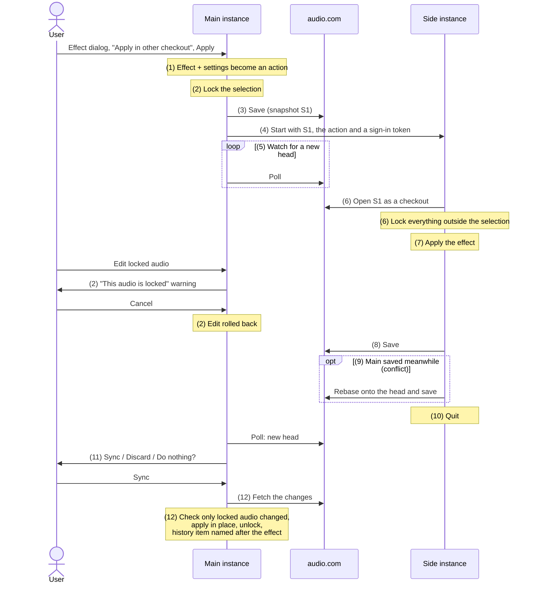

# "Apply in other checkout" flow

A destructive effect is applied by a second Audacity instance (the "side", later a cloud effect) working on a checkout of the project. Meanwhile the user can keep working in the main instance.

## Steps

| Step | What                                                                                                                    | Depends on | Remarks                                                                                                                                                  |
| ---- | ----------------------------------------------------------------------------------------------------------------------- | ---------- | -------------------------------------------------------------------------------------------------------------------------------------------------------- |
| 1    | Effect dialog option; effect settings serialized as an `action://effects/apply?…` query                                 |            | Option is demo code. In prod, cloud effects have a little icon.                                                                                          |
| 2    | Lock the selection: split edge blocks, lock inner blocks, `modifyState` + `markUnsaved`, locked audio visual indication | F1         | An undo past the locking throws a "Cancel job?" warning. Improvement ideas welcome.                                                                      |
| 3    | Save to audio.com before handing over (also for new, never-saved projects)                                              |            | UX: careful with this requirement. Would work on local server without an account.                                                                        |
| 4    | Start the side process: `--checkout`, own sync database, action, sign-in token handed over safely (?)                   |            | (?): written to a file, readable by users only, and deleted after read by side job. Need to figure out how it will be when side runs on audiocom server. |
| 5    | Poll audio.com for a new project head                                                                                   |            |
| 6    | Open a snapshot as a checkout; lock its complement                                                                      | 2          |
| 7    | Dispatch the action once the project is open                                                                            | 1, 6       |
| 8    | Save the checkout to audio.com                                                                                          |            |
| 9    | Rebase the checkout onto the head on version conflict                                                                   | F2         |
| 10   | Quit once saved                                                                                                         | 8, 9       |
| 11   | Ask the user what to do with the new head                                                                               | 5          |
| 12   | Integrate the head in place, keeping unsaved work; name the history item                                                | F2         |

Foundations, needed before the steps above:

- **F1** Persistent clip and track IDs (`uid`), so clips can be matched across copies of the project.
- **F2** Project patches: compute what a checkout changed (replaced blocks, new clips/tracks) and apply it to another version of the project, with unit tests. Depends on F1.
