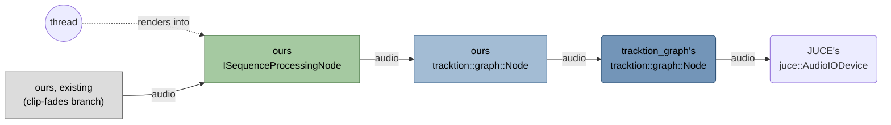
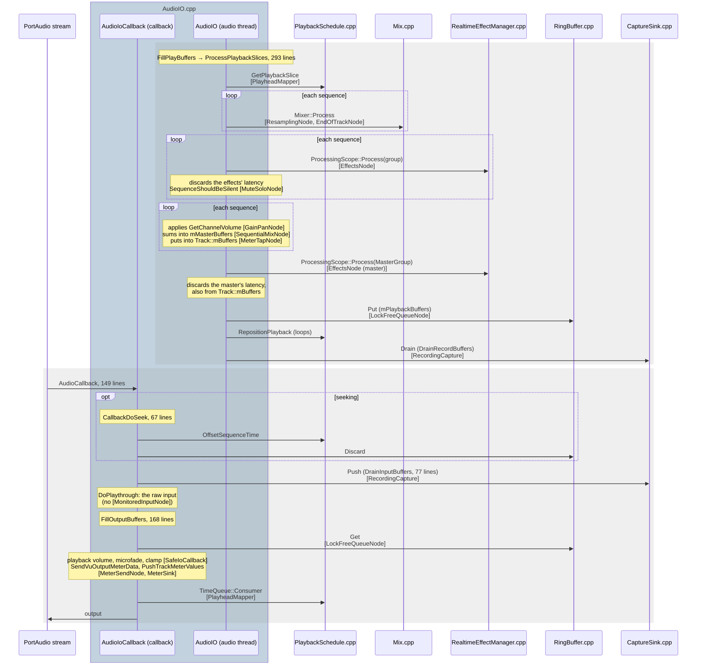

## Audio graph

```mermaid
flowchart LR
    T1["track chain (w/ fx)"] --> Q1[LockFreeQueueNode] --> M1["MeterTapNode"]
    T2["track chain (w/ fx)"] --> Q2[LockFreeQueueNode] --> M2["MeterTapNode"]
    W((a worker per track)) -.->|render into| Q1 & Q2
    S3[PlayheadMappingNode] --> Q3[LockFreeQueueNode] --> E3[EndOfTrackNode] --> IM3[SequentialMixNode]
    I3[MonitoredInputNode] --> IM3 --> FX3[EffectsNode] --> MS3[MuteSoloNode] --> GP3[GainPanNode] --> M3["MeterTapNode"]
    W3((worker)) -.->|reads into| Q3
    M1 & M2 & M3 -->|one after the other| Mix[SequentialMixNode] --> MFX["EffectsNode (master)"] --> MMeter["MeterTapNode (master)"] --> MSend[MeterSendNode] -->|callback| D(device)
    style Q1 fill:#a5c9a1,stroke:#4f7a4a,color:#000
    style M1 fill:#a5c9a1,stroke:#4f7a4a,color:#000
    style Q2 fill:#a5c9a1,stroke:#4f7a4a,color:#000
    style M2 fill:#a5c9a1,stroke:#4f7a4a,color:#000
    style S3 fill:#a5c9a1,stroke:#4f7a4a,color:#000
    style Q3 fill:#a5c9a1,stroke:#4f7a4a,color:#000
    style E3 fill:#a5c9a1,stroke:#4f7a4a,color:#000
    style IM3 fill:#a5c9a1,stroke:#4f7a4a,color:#000
    style I3 fill:#a5c9a1,stroke:#4f7a4a,color:#000
    style FX3 fill:#a5c9a1,stroke:#4f7a4a,color:#000
    style MS3 fill:#a5c9a1,stroke:#4f7a4a,color:#000
    style GP3 fill:#a5c9a1,stroke:#4f7a4a,color:#000
    style M3 fill:#a5c9a1,stroke:#4f7a4a,color:#000
    style Mix fill:#a5c9a1,stroke:#4f7a4a,color:#000
    style MFX fill:#a5c9a1,stroke:#4f7a4a,color:#000
    style MMeter fill:#a5c9a1,stroke:#4f7a4a,color:#000
    style MSend fill:#a5c9a1,stroke:#4f7a4a,color:#000
```

Here the playback tracks' chains, mute/solo and volume/pan included, stop before their meter's tap, which the callback reads
after the queue, where the device is. The monitored track's chain runs in the callback from its `EndOfTrackNode` on: its
mute/solo and volume/pan are heard at once.

Here is the track chain:

```mermaid
flowchart LR
    C[sequence's graph] --> S[PlayheadMappingNode] --> End[EndOfTrackNode] --> FX[EffectsNode] --> MS[MuteSoloNode] --> GP[GainPanNode] --> Meter[MeterTapNode]
    style S fill:#a5c9a1,stroke:#4f7a4a,color:#000
    style End fill:#a5c9a1,stroke:#4f7a4a,color:#000
    style FX fill:#a5c9a1,stroke:#4f7a4a,color:#000
    style MS fill:#a5c9a1,stroke:#4f7a4a,color:#000
    style GP fill:#a5c9a1,stroke:#4f7a4a,color:#000
    style Meter fill:#a5c9a1,stroke:#4f7a4a,color:#000
    style C fill:#dcdcdc,stroke:#707070,color:#000
```

### Legend

Color and shape convention throughout the graphs:

What a node needs beyond its input, it gets from a context it's given at construction:

- `IEffectsContext`: processes a group's effects on buffers, in the current block's processing scope; their latency.
- `IMuteSoloContext`: whether any track solos, this block.
- `IEndOfTrackContext`: where the play range ends, unless looping.

## New building blocks

| Block                                                       | Role                                                                                                                                                                                                                                       |
| ----------------------------------------------------------- | ------------------------------------------------------------------------------------------------------------------------------------------------------------------------------------------------------------------------------------------ |
| `Au4AudioEngine : IAudioEngine`                             | Counterpart to `Au3AudioEngine`, on the devices its `IDeviceOpener` opens: one instance per audio library                                                                                                                                  |
| `AudioEngineSwitcher` (`src/audio`)                         | The exported `IAudioEngine` and `IAudioDriverController`: forwards to the engine chosen in the audio preferences or the playback toolbar                                                                                                   |
| `IDevice`, `IDeviceOpener`, `IHardwareVolume` (`src/audio`) | An open audio device, which calls back an `IDeviceCallback`; what opens them as the audio settings say; their hardware input volume                                                                                                        |
| `PortAudioDevice` (`src/portaudiodevices`)                  | PortAudio's, opened as AudioIO opens its streams (`PortAudioStream`)                                                                                                                                                                       |
| `JuceDevice` (`src/jucedevices`)                            | JUCE's                                                                                                                                                                                                                                     |
| `PortAudioStream`, `DeviceMixer` (au3, from AudioIO)        | Opens PortAudio streams as the audio settings say, minding each host's quirks; the hardware input volume and playthrough, through portmixer                                                                                                |
| `CaptureSink` (au3, from AudioIO)                           | Moves the captured input into the sequences being recorded; dropouts, latency compensation                                                                                                                                                 |
| `IoCallback`                                                | Implements `IDeviceCallback` while playing or recording: builds the chains, renders the mix, the master's and the monitored track's chains, and waits for the tracks' workers; applies the playback volume, reports what plays             |
| `MonitoringCallback`                                        | Idle monitoring: meters the input, plays it through, raw or through the effects                                                                                                                                                            |
| `RecordingCapture`                                          | Records the device's input as AudioIO does: a `CaptureSink` filled by the device callback, drained by a worker; sound activated recording                                                                                                  |
| `CaptureInput`                                              | The device's input as captured: with the input volume applied, and metered                                                                                                                                                                 |
| `PlayheadMapper : IPlayheadMapper`                          | Maps linear stream indices to the timeline positions the playhead reads: seeks, loops                                                                                                                                                      |
| `PlayheadMappingNode` (au3)                                 | Reads a sequence's graph by stream index, where an `IPlayheadMapper` says                                                                                                                                                                  |
| `ResamplingNode` (au3)                                      | Converts a sequence's rate to the device's                                                                                                                                                                                                 |
| `LockFreeQueueNode` (au3)                                   | Renders its input ahead on its own worker thread, into a lock-free queue read by stream index; on a seek, drops what it queued                                                                                                             |
| `Track`                                                     | Not a node: a track's chain as the callback keeps it: its output for the mix, its queue, its meter tap                                                                                                                                     |
| `BlockContext`, `BlockContextNode`                          | The state of the block being rendered, which the chains' nodes share (`IEffectsContext`, `IMuteSoloContext`, `IEndOfTrackContext`); one per worker rendering a whole chain, one for the device callback; set around each block by the node |
| `EndOfTrackNode`                                            | Silences the track where it ends: past the play range's end unless looping, or where a lead-in recording starts; before the effects, so that their tails ring out                                                                          |
| `EffectsNode`                                               | A group's realtime effects (a track's or the master's): reads its input ahead by their latency and primes them when reading jumps                                                                                                          |
| `MuteSoloNode`                                              | Silences the track as mute/solo say, whether another track solos coming from its `IMuteSoloContext`                                                                                                                                        |
| `GainPanNode`                                               | Volume/pan; where a mono track becomes stereo                                                                                                                                                                                              |
| `MeterTapNode`                                              | Keeps what passes, and its stream index, for a meter                                                                                                                                                                                       |
| `MeterSender`                                               | Not a node: once the device callback has rendered a block, sends to the meters what the taps kept of it, stamped with when it's heard                                                                                                      |
| `SequentialMixNode`                                         | Sums its inputs one after the other: the tracks, or the monitored track's source and the input                                                                                                                                             |
| `MonitoredInput`                                            | Not a node: the input of the block being rendered, with the input volume                                                                                                                                                                   |
| `MonitoredInputNode`                                        | The input as a source, live where its chain renders the block; a `SequentialMixNode` sums it with the monitored track's source                                                                                                             |

## The same in AudioIO

What does each block's job in `Au3AudioEngine`'s playback (`au3/libraries/au3-audio-io` and the libraries it calls). AudioIO
always renders on its audio thread (`AudioIO::AudioThread`) and plays what it rendered through one ring buffer per channel,
as the safe mode does.

In the diagram, the arrows are calls, to code with a class and file of its own; the notes on `AudioIO.cpp` are what it
does itself, inline in its functions (the file has 3127 lines; the functions' lengths are given). In brackets, our block
that does the same.

