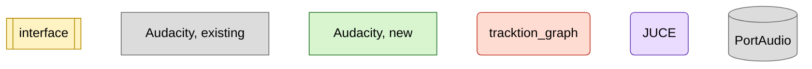
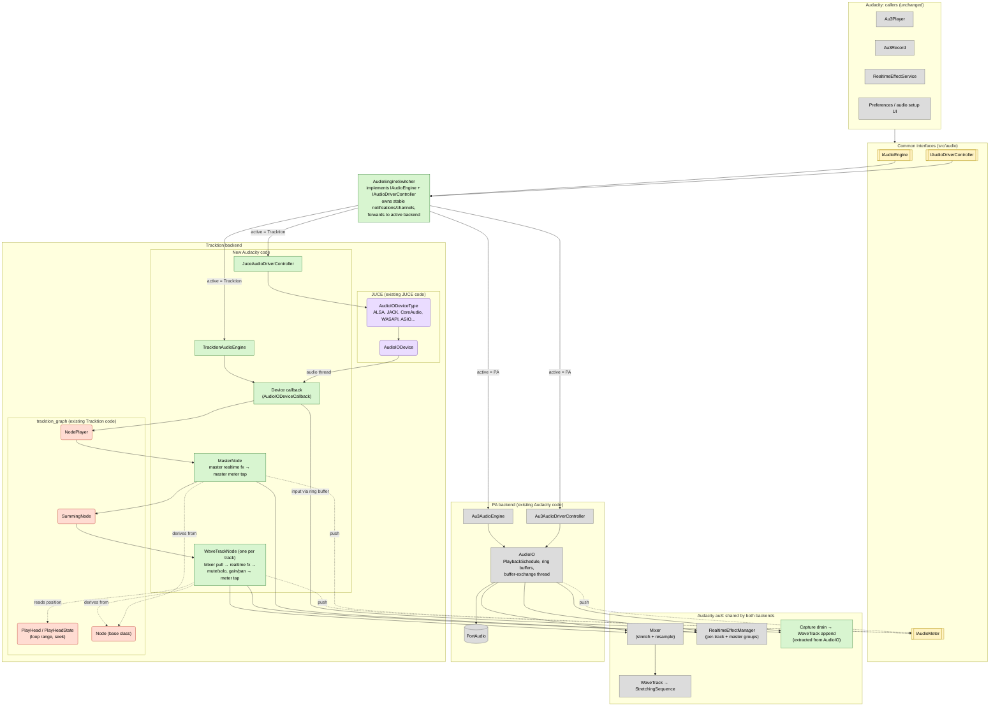

Rectangles are Audacity's code; rounded ones come with JUCE or tracktion_graph.

Legend: yellow = common interfaces · blue = existing Audacity code · green = new or refactored Audacity code · red = existing tracktion_graph code · purple = existing JUCE code.

## Most complex classes

Most complex first:

1. `TracktionPlaybackStream`: `src/au3audio/internal/tracktion/tracktionplaybackstream.{h,cpp}`, on `PlaybackStream`: `src/au3audio/internal/juce/playbackstream.{h,cpp}`
2. `LockFreeQueueNode`: `au3/libraries/au3-clip-processing/sequence-graph/LockFreeQueueNode.{h,cpp}`
3. `JucePlaybackStream`: `src/au3audio/internal/juce/juceplaybackstream.{h,cpp}`, with `JuceWorkerPlaybackStream` and `JuceDevicePlaybackStream`: `src/au3audio/internal/juce/{juceworkerplaybackstream,jucedeviceplaybackstream}.{h,cpp}`, with `MixNode` and `TrackNode`: `src/au3audio/internal/juce/{mixnode,tracknode}.{h,cpp}`
4. `StreamPlayHead`: `src/au3audio/internal/juce/streamplayhead.{h,cpp}`
5. `SequenceNode`: `src/au3audio/internal/tracktion/sequencenode.{h,cpp}`, with `SequenceRenderer`: `src/au3audio/internal/juce/sequencerenderer.{h,cpp}`
6. `JuceAudioEngine`: `src/au3audio/internal/juce/juceaudioengine.{h,cpp}`
7. `PlaybackScheduleNode`: `au3/libraries/au3-clip-processing/sequence-graph/PlaybackScheduleNode.{h,cpp}`, with `PlayHeadSchedule`: `src/au3audio/internal/tracktion/playheadschedule.{h,cpp}`

## Behavior differences: PortAudio (AudioIO) vs JUCE (worker) vs JUCE (device) vs Tracktion

For A/B testing. Verdicts are against PortAudio: ✅ better · ＝ parity · ⚠️ regression or risk · ? to verify. JUCE (worker) renders as AudioIO does, a worker 0.25 s ahead into a queue; JUCE (device) renders as Tracktion does, in step with the device, but on the device thread only; Tracktion renders in step with the device, on a thread pool.

| Area | PortAudio / AudioIO | JUCE (worker) | JUCE (device) | Tracktion | JUCE (worker) | JUCE (device) | Tracktion | Since |
|---|---|---|---|---|---|---|---|---|
| Dependencies | PortAudio, PortMixer | JUCE: core, events, audio_basics, audio_devices (built with AU_USE_JUCE=ON, AU_USE_TRACKTION=OFF: links and plays, no tracktion symbol in the binary) | Same as JUCE | JUCE's, plus juce_audio_formats, tracktion_core, tracktion_graph | — | — | — | 90860f33bd |
| Choosing the backend | Audio preferences > Audio engine; persists, applies at once (playback resumes on the new backend, monitoring restarts, recording stops); AU_AUDIO_BACKEND overrides it for a run | Same | Same | Same | — (A/B tool) | — (A/B tool) | — (A/B tool) | ec750b3190, 0c1e5d4b9e, 61a3a2159b |
| Mute / solo during play | Heard after the playback ring buffer and PortAudio's buffering: 0.47–0.59 s measured (Linux, PipeWire, Buffer size 1 ms; reports ~1 ms latency) | Heard after what is rendered ahead: 0.20–0.26 s measured (Buffer size 12 ms) | Heard within one device block | Heard within one device block | ✅ | ✅ | ✅ | 10436c9f0a, 0c1e5d4b9e |
| Realtime effect edits during play | Heard after the ring buffer | Heard after what is rendered ahead | Heard within one device block | Heard within one device block | ＝ | ✅ | ✅ | 10436c9f0a, 0c1e5d4b9e |
| Loop-region edits during play | Heard after the ring buffer | Heard at once by the play head; if the 0.25 s rendered ahead no longer matches, silence while the worker renders it (~10 ms) | Same as Tracktion | Heard at once by the play head; if the 0.25 s read ahead no longer matches, ~0.1 s of silence | ＝ | ＝ | ＝ | fd44723537, 0c1e5d4b9e |
| Seek during play | Buffers refilled; gap not measured; no fade | Play head jumps at once; silence while the worker renders (12 ms measured); no fade | Play head jumps at once; ~0.1 s of silence until the workers resync; no fade | Play head jumps at once; ~0.1 s of silence until the worker resyncs; no fade (primed, cross-faded seeks: local branch tracktion-cross-faded-seeks, out of scope) | ＝ | ＝ | ＝ | fd44723537, 0c1e5d4b9e |
| Loops shorter than a device block (~10–20 ms) | Looped; play head right | Looped; play head right (unit-tested, not run) | Same as JUCE | Looped; play head right | ＝ | ＝ | ＝ | 10436c9f0a, 65a588fd23 |
| Effect latency, between tracks and absolute | Tracks read ahead; leading samples dropped | Same as AudioIO, for tracks and master | Same as JUCE | Graph delays shorter paths; pre-roll at start | ＝ | ＝ | ＝ | 36ec8b5deb, 0c1e5d4b9e |
| Effect latency changing during play (add/remove/bypass, lookahead) | Not re-compensated; a newly added effect may drop samples on its track | Not re-compensated | Not re-compensated | Not re-compensated; the track stays shifted until the next play | ? | ? | ? | 36ec8b5deb |
| Effect tails at end of play range | Cut | Cut | Cut | Cut | ＝ | ＝ | ＝ | 36ec8b5deb |
| Disk reads, stretching, resampling | Worker thread, 0.25 s ahead | In the mix worker, 0.25 s ahead | Worker thread per track, 0.25 s ahead | Worker thread per track, 0.25 s ahead | ＝ | ＝ | ＝ | fd44723537, 0c1e5d4b9e |
| Realtime effects processing | One worker thread, all tracks in series, 0.25 s ahead of the device | Same | The device thread, all tracks in series, in step with each device block | Tracktion's thread pool, tracks in parallel, in step with each device block | ＝ | ⚠️ (less headroom: no buffering to absorb jitter, no pool to share the work) | ✅/⚠️ (more tracks of effects fit; a single effect's spike longer than a block drops out, which buffering absorbs) | aeeb7d34e4, 0c1e5d4b9e |
| Overload, measured with CPU Load: 4 mono tracks, 10 s, 11.6 ms blocks, RelWithDebInfo, headless | Starves from 30% per track: plays late after silence, 1.4 s of it at 30%, 4.1 s at 50%, 5.0 s at 80% | Same: 1.1 s at 30%, 4.1 s at 50%, 5.5 s at 80% | 1 late callback at 20% per track (longest 14.7 ms of 11.6), nearly all late from 30% (765) | Clean up to 80% per track (longest callback 11 ms of 11.6) | ＝ | ⚠️ | ✅ | cf3bf8a7c2, 2361bf6b99, 0c1e5d4b9e |
| Spikes, measured with CPU Load: 1 track, a 30 or 100 ms spike every 2 s, RelWithDebInfo | Absorbed | Absorbed | A late callback per spike (31.9 ms, 95.8 ms) | A late callback per spike (33.5 ms, 101.7 ms for 11.6 ms blocks) | ＝ | ⚠️ | ⚠️ | cf3bf8a7c2, 0c1e5d4b9e |
| Meters during play | Pushed as played | Pushed by the worker, 0.25 s ahead, with the time they will be heard | Pushed by the device thread after each block | Pushed by the device thread after each block | ＝ | ＝ | ＝ | 0c1e5d4b9e |
| Input monitoring (meter, playthrough) | Yes, raw input | Yes, raw input (Tracktion's code) | Same as JUCE | Yes, raw input | ＝ | ＝ | ＝ | a3bcdf500b |
| Buffer size setting | Asked of PortAudio as latency (here ~43 ms reported whatever the setting) | The device buffer: the longest offered not longer than the setting; on ALSA at least 512 frames (shorter ones open but stay silent with PipeWire) | Same as JUCE (worker) | Same as JUCE (worker) | ＝ | ＝ | ＝ | a50ea6d299 (fixup of 10436c9f0a) |
| Input played through the effects | No: raw input | No: raw input (its effects run ahead, not in the callback) | Through the focused track, if its channels match the input (the track the mic meter shows on), then the master; else the master only. Idle and while recording alike; recordings stay raw. If the track plays, the input joins it before its effects, so its mute/solo and volume/pan apply too | Same as JUCE (device) | ＝ | ✅ | ✅ | 45de772e96 |
| Monitoring through the effects while a recording is paused | n/a: raw input played through | n/a | Silent until resumed (nothing renders while paused) | Same as JUCE (device) | — | ❌ | ❌ | 45de772e96 |
| Monitored input on the meters, through the effects | Not on the playback meters | Same | On the main playback meter, and on the monitored track's if it plays | Same as JUCE (device) | — | ⚠️ (minor) | ⚠️ (minor) | 45de772e96 |
| Monitored track changed while recording | n/a | n/a | Kept until the recording stops; idle monitoring follows focus at once | Same as JUCE (device) | — | ⚠️ (minor) | ⚠️ (minor) | 45de772e96 |
| Input volume | Device's mixer level where PortMixer can set it, else applied to the samples | Always applied to the samples (JUCE has no device mixer access) | Same as JUCE | Same as JUCE | ⚠️ (input can clip before the volume where AudioIO would lower the device level) | ⚠️ (same) | ⚠️ (same) | a3bcdf500b |
| Devices held while monitoring | Input only, unless played through | Input and output (JUCE's ALSA devices stall with input only) | Same as JUCE | Same as JUCE | ⚠️ (minor) | ⚠️ (minor) | ⚠️ (minor) | a3bcdf500b |
| Main input meter, inputs of more than 2 channels, while monitoring | Silent | Loudest channel per side | Same as JUCE | Same as JUCE | ✅ | ✅ | ✅ | a3bcdf500b |
| Recording (new track, overdub, lead-in punch and roll, pause) | Yes | New track run; the rest is Tracktion's code, not run | New track run; the rest is shared code, not run | Yes; clip lengths within run-to-run timing noise | ＝ (partly verified) | ＝ (partly verified) | ＝ | 4cbaab693c, 0c1e5d4b9e |
| Capture format | Device gives the sequences' format | Floats, converted by the capture sink | Same as JUCE | Same as JUCE | ＝ (likely inaudible) | ＝ (likely inaudible) | ＝ (likely inaudible) | 4cbaab693c |
| Dropouts from device input overflow | Marked, filled with silence | Not detected (JUCE counts them together with output underruns); capture-buffer overflows still are | Same as JUCE | Same as JUCE | ⚠️ (minor) | ⚠️ (minor) | ⚠️ (minor) | 4cbaab693c |
| Device underruns while playing | Counted (paOutputUnderflow) | Counted (JUCE xruns); under PipeWire's ALSA, neither reports any | Same as JUCE | Same as JUCE | ＝ | ＝ | ＝ | 2361bf6b99 |
