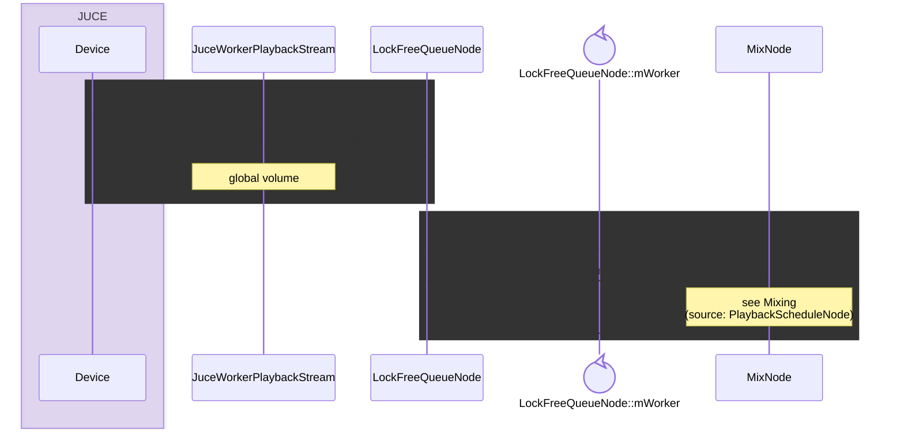
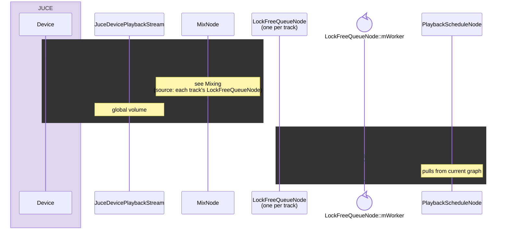
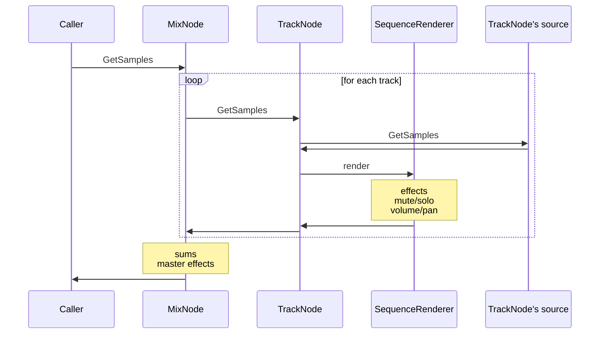
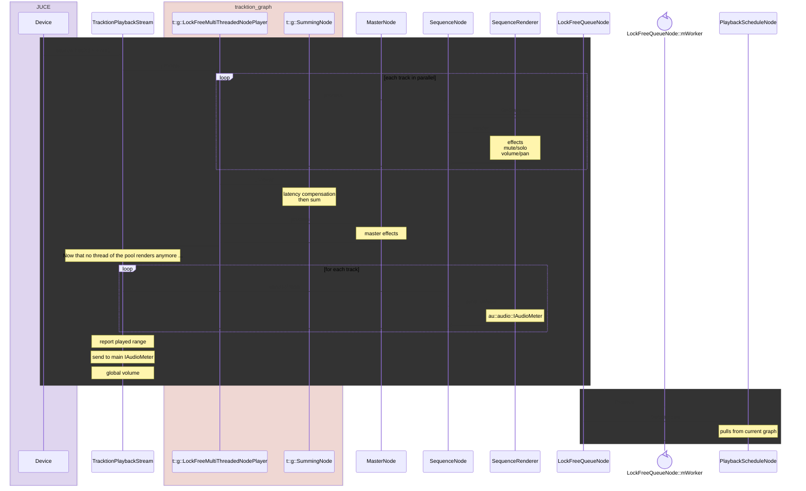
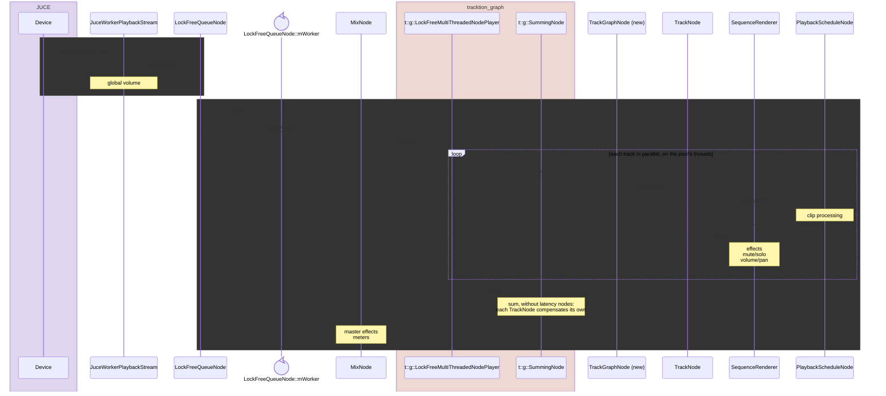

# Main blocks

In the architectures below, always found together:

### "Clip" processing

1. reads audio from our SQLite database (slow)
2. time stretching (possibly heavy)
3. clip fades
4. clip envelope

### "Mixing"

1. per-track effects
2. master effects

# Architecture options

## JUCE only options

### Option 1: Worker

Device just does volume.

One worker thread does mixing + clip processing, behind buffer.

### Option 2: Device

Device does mixing.

### Common to both options

This block is common to both JUCE variants:

## Tracktion option

## Tracktion worker option (proposed)

Device just does volume.

One worker thread, with tracktion's pool, does mixing + clip processing, tracks in parallel, behind buffer. As Option 1, but
`MixNode` sums its tracks through a tracktion player instead of one after the other. New: `TrackGraphNode`, the glue
from tracktion's graph to our `TrackNode`.

